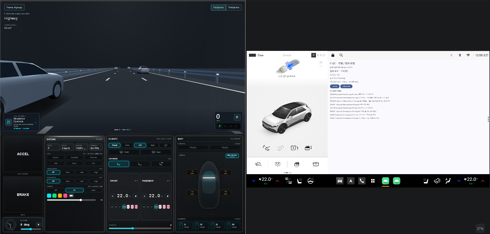
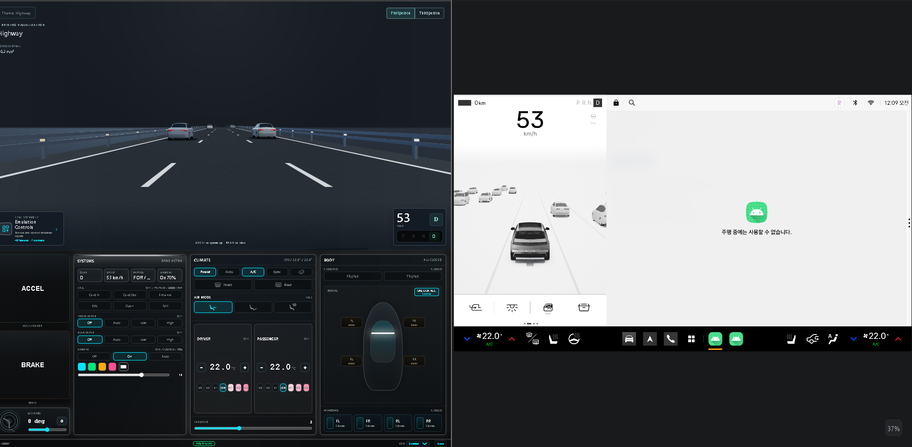

# F-01 에뮬레이터 연동 확인

2026-11-05에 촬영한 실행 화면이다. 왼쪽은 Pleos Connect Virtual Console, 오른쪽은 Pleos Connect v2.1.0 에뮬레이터다. F-01 앱은 **실제 신호 연결(AAOS)** 모드로 실행했다. 여기서 실제 신호란 실차가 아닌 에뮬레이터가 제공하는 차량 신호를 뜻한다.

구현 내용과 자동 테스트 결과는 [F-01 구현·검증 안내](../README.md)를 참고한다.

## 주차: 0 km/h · P



- 콘솔과 에뮬레이터가 모두 **0 km/h · P**를 표시한다.
- F-01 앱에 **정차 모드 · 주차(P)**, **차량 판정: 주차**가 표시된다.
- 앱의 수신 값은 `속도 0.00 km/h · P=true · UX 제한=false`다.
- 최근 판정 기록에서 `physical=Parked app=Parked`를 확인할 수 있다.

## 주행: 53 km/h · D



- 콘솔과 에뮬레이터가 모두 **53 km/h · D**를 표시한다. 콘솔의 주행 입력이 에뮬레이터에 반영되는 것을 확인했다.
- 오른쪽의 **주행 중에는 사용할 수 없습니다**는 **Pleos 시스템의 화면 제한 안내**다. RoadMystery가 구현한 주행 미니 뷰가 아니다.
- 이 사진에서는 앱 내부의 주행 판정 로그가 가려지므로, 사진만으로 F-01의 Driving 이벤트 발행이나 전환 지연까지 확인할 수는 없다. 해당 검증 결과는 상위 문서와 테스트에 별도로 기록했다.

## 재현 순서

1. Pleos 에뮬레이터를 실행하고 디버그 앱에서 **F-01 단독 판정 테스트 → 실제 신호 연결**을 선택한다. 요청되는 차량 신호 권한을 허용한다.
2. PC 터미널에서 포트 연결을 설정한다.

   ```text
   adb forward tcp:8088 tcp:8088
   ```

3. 브라우저에서 [Virtual Console](http://127.0.0.1:8088/)을 연다.
4. **D → ACCEL**로 가속하고 콘솔과 에뮬레이터의 속도를 비교한다.
5. **BRAKE**로 속도를 0까지 낮춘 뒤 **P**로 전환한다. F-01 화면에서 주차 판정과 수신 값을 확인한다.

에뮬레이터나 ADB를 재시작한 뒤 콘솔 조작이 반영되지 않으면 포트 연결 명령을 다시 실행하고 브라우저를 새로고침한다. D 상태의 정차에서는 플랫폼의 UX 제한이 유지될 수 있으므로, 차량 정차 판정과 앱 화면 허용 여부를 구분한다.

이 자료는 에뮬레이터 연동 확인용이며, 실차 검증이나 F-03·F-09·F-10 완료를 의미하지 않는다.
