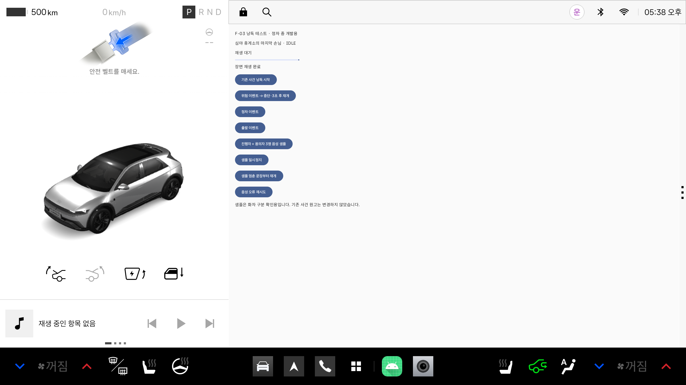

# F-03 실행 확인

검증일: 2026-11-06 (한국 시간). 환경: Pleos Connect v2.1.0, API 34, x86_64, TTS 3.3.1 ON_DEVICE. 로그는 에뮬레이터 기기 시각으로 기록된다.

## 네 화자와 중단·재개

[앱 전용 로그](verification/voice-sample.log)

- 샘플 첫 문장(index 0) 중단 → `onStop` 확인 → 같은 index 0으로 재개.
- sanghyeok → seoyoon → eunwoo → haeun 순서로 요청·완료 확인.
- 각 화자에서 0보다 큰 재생 RMS 콜백(`audible PCM reported`) 확인. 호스트 스피커를 사람이 직접 청취한 검증은 아니다.
- 마지막 문장 후 질문 안내를 합성하고, 완료 후 약 3초 대기한 다음 `SceneFinished` 1회 발행.
- 수정 후 해당 실행 로그에 합성 오류 없음.

## 원본 대본 + F-10 엔진

[앱 전용 로그](verification/engine-hazard.log)

- 원본 사건의 `s01_scene`, index 1부터 재생.
- 17:39:08: 위험 이벤트를 넣어 PAUSED로 전환하고 실제 TTS stop 응답 확인.
- 17:39:11: 3초 후 재개 안내를 읽음.
- 17:39:13: 동일 장면 index 1부터 다시 재생, 음성 RMS 확인.
- 17:39:20: 두 번째 위험 발생. 3초가 지나도 PAUSED 유지.
- 17:39:26: 정차 이벤트 후 안내·동일 문장 재개.
- 이후 index 2, 3으로 순차 진행. 테스트 종료 시 음성 중단.

이는 앱에 전달한 시뮬레이션 위험 이벤트의 통합 검증이다. 차량의 실제 급제동/ADAS 감지와 위험 해제 판정은 검증 범위가 아니다.

재현 명령:

```sh
adb shell am force-stop com.roadmystery.app
adb shell am start -W -n com.roadmystery.app/.audio.NarrationTestActivity --ez engineSmoke true
```

## 테스트 화면



화면 자체는 음성 재생의 증거가 아니므로 위 로그와 함께 확인한다. 음성 샘플 버튼을 누르면 기존 사건 재생과 재개 예약을 종료한 다음 샘플을 재생한다. 샘플 일시정지·재개 버튼은 사건 재생 중에는 비활성화된다.

## 자동 검증

단위 테스트 53개 통과(실패 0, 새 낭독 테스트 8개 및 화면 전환 시 재개 예약 취소 테스트 포함). APK 빌드와 ktlint 통과. Android lint는 오류 0개·경고 25개이며 경고는 남아 있다. 실제 운전 중 오디오 포커스 경쟁·서비스 재시작·장시간 전체 사건 완주는 추가 검증 대상이다.
